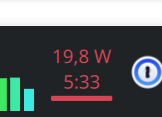
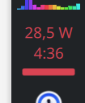
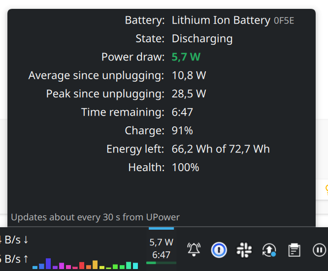
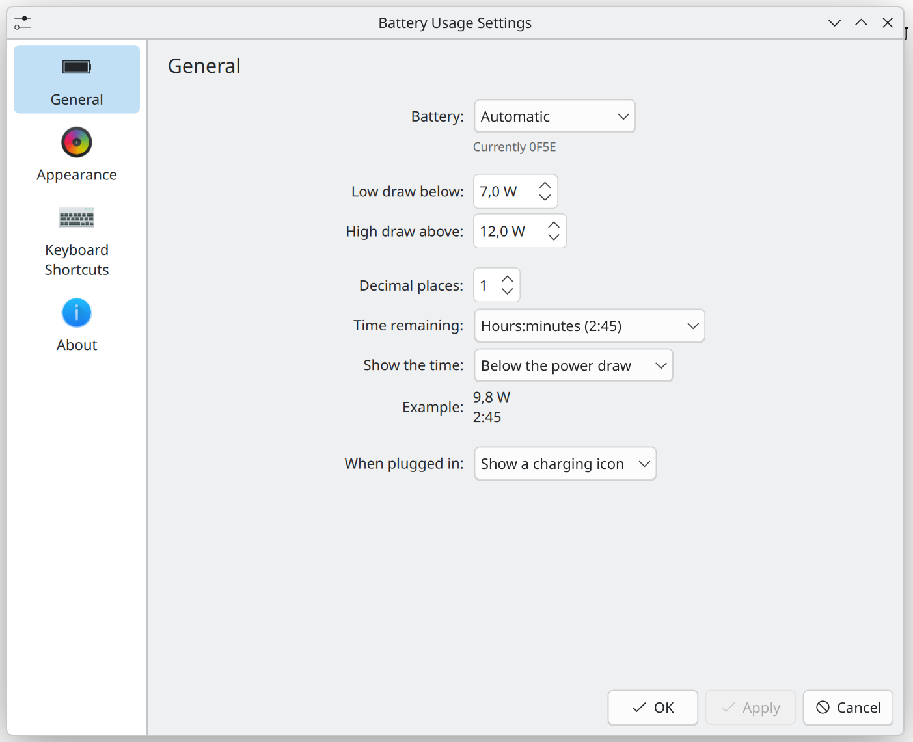

# Battery Usage

A Plasma 6 widget that shows, while the laptop runs on battery, how much
power is being drawn and how long the battery will last, with a colour cue
when the draw is high. Click it for details.

- **Panel (horizontal):** the power draw (`9.8 W`) with the time left under
  it (`2:45`), or both on one line (`9.8 W · 2:45`), over a thin bar. The bar
  is green below 6 W, the accent colour between 6 and 12 W and red above
  12 W, where the text turns red too. Thresholds and colours are
  configurable. Other layouts: text right or left of the bar, bar only, text
  only.
- **Panel (vertical):** watts over time over a thin bar, dropping decimals
  and then the time when the panel is too narrow.
- **When plugged in** the widget hides itself (it stays visible in Edit Mode
  so you can still reach its settings). It can show a charging icon or "AC"
  instead.
- **Popup / desktop:** power draw, average and peak since unplugging,
  remaining time, charge, energy left and battery health.
- Remaining time as `2:45`, `2h 45m`, `2.8 h` or hidden; 0–2 decimals for
  watts.

## Screenshots

| Horizontal panel | Vertical panel |
|---|---|
|  |  |





## Requirements

Plasma 6 with `ksystemstats` running (it ships with Plasma System Monitor and
the standard system monitor widgets).

Readings come from UPower through `ksystemstats`, so they refresh about every
30 seconds on battery, and show "—" for a moment after unplugging while
UPower estimates the first value.

ksystemstats also lists the batteries of Bluetooth devices (headsets, mice).
*Automatic* picks the largest battery that isn't one of those. You can choose
a specific battery in the settings. With two laptop batteries only the larger
one is shown; summing them is future work.

The charging state and the smoothed time estimate come from the same private
module the stock battery applet uses (`org.kde.plasma.private.battery`). If a
future Plasma changes or drops it, the widget falls back to the sign of the
reported rate and computes the time from the energy left. It keeps working,
just with a less smooth estimate.

## Install

Download the `.plasmoid` from the
[latest release](https://github.com/frapell/battery-usage-widget/releases/latest)
and install it with *Add Widgets → Get New Widgets → Install Widget From Local
File…*, or `kpackagetool6 -t Plasma/Applet -i <file>`.

From source:

```sh
make install        # first time
make upgrade        # afterwards
make restart        # restart plasmashell to drop the QML cache
```

`make build` runs the tests, compiles any translations in `po/` and writes
`dist/org.frapell.batteryusage-<version>.plasmoid`. That file can be
installed with `kpackagetool6 -t Plasma/Applet -i <file>` or uploaded to the
KDE Store.

## Development

| Command | What it does |
|---|---|
| `make test` | Unit tests for the formatting and statistics code (needs `node`) |
| `make view` | Opens the widget in a window with `plasmawindowed` |
| `make log` | Follows plasmashell's log, filtered to QML and this widget |
| `make pot` | Regenerates the translation template in `po/` (needs `gettext`) |

The formatting and statistics code lives in `package/contents/ui/code/` as
plain JavaScript with no QML dependencies, so the tests load it directly.

## Releasing

1. Bump `KPlugin.Version` in `package/metadata.json` and commit.
2. Tag and push: `git tag v0.2.0 && git push origin v0.2.0`.
3. The [Release workflow](.github/workflows/release.yml) checks that the tag
   matches the version, runs the tests, builds the `.plasmoid` and publishes a
   GitHub release with it attached.
4. To publish on the KDE Store, upload the `.plasmoid` from the release under
   *Files* on the product page, with the same version and a changelog entry.
   The store has no upload API, so this step is manual.

## Translations

All user-visible strings go through `i18n()`. See [`po/README.md`](po/README.md)
for how to add a language.

## License

GPL-2.0-or-later. See `LICENSE`.
